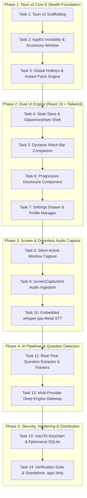

# Sidekick Implementation Plan

> **Superseded (17 Oct 2026).** This is the original build plan, kept as history; its body is not updated. For current behaviour (shortcuts, Settings layout, models, threads, panic), read [`cluely-parity-plan.md`](../cluely-parity-plan.md) and the [README](../../README.md).

This document defines the phased, task-by-task engineering roadmap for building Sidekick. Each task is self-contained with explicit pre-conditions, detailed technical instructions, target files, acceptance criteria, and verification commands.

---

## 1. Global Constraints & Principles

All tasks MUST adhere to the binding architectural requirements established in [`spec-architecture-sidekick-copilot.md`](../spec-architecture-sidekick-copilot.md):
1. **Screen-Share Invisibility**: All overlay windows MUST be initialized with `NSWindowSharingNone` (`NSWindow.sharingType = .none`).
2. **Accessory App Policy**: The process MUST run under `NSApplicationActivationPolicyAccessory` (zero Dock icon, excluded from `Cmd + Tab`).
3. **Z-Index & Fullscreen Persistence**: Overlay MUST be assigned `NSWindow.Level.floating` and `NSWindowCollectionBehaviorFullScreenAuxiliary`.
4. **Instant Panic**: `Cmd + Esc` MUST synchronously hide all windows and abort network/audio pipelines within < 25ms.
5. **Credential Security**: All API keys MUST be stored only in `~/.config/sidekick/config.json` (mode `0600`). This replaces the original Keychain rule, which was superseded on 2026-10-16 (see Task 13).
6. **Ephemeral Privacy**: Zero external telemetry. Audio PCM buffers MUST be processed in memory and never stored as raw audio files.
7. **Resource Budgets**: Idle RAM < 45MB; active meeting CPU < 6% on Apple Silicon.

---

## 2. Implementation Phases & Task Breakdown

---

### Phase 1: Tauri v2 Native Core & Stealth Window Foundation

#### Task 1: Tauri v2 Scaffolding & Configuration
* **User Story**: As a developer, I need the baseline Tauri v2 + React 19 + TypeScript + Vite project configured with required macOS entitlements and permissions.
* **Pre-conditions**: Workspace is initialized with git.
* **Implementation Details**:
  * Initialize Tauri v2 with React, TypeScript, and Vite.
  * Install frontend dependencies: `tailwindcss@3`, `lucide-react`, `zustand`, `clsx`, `tailwind-merge`.
  * Configure `src-tauri/Cargo.toml` with `tauri = { version = "2", features = ["macos-private-api"] }`, `cocoa = "0.26"`, `objc = "0.2"`.
  * Configure `src-tauri/tauri.conf.json`:
    * Title: `Sidekick`
    * Windows: `transparent: true`, `decorations: false`, `alwaysOnTop: true`, `skipTaskbar: true`.
    * Mac entitlements: Microphone access, Screen capture.
* **Target Files**:
  * `package.json`
  * `vite.config.ts`
  * `tailwind.config.js`
  * `src-tauri/Cargo.toml`
  * `src-tauri/tauri.conf.json`
* **Verification**:
  * `cargo check --manifest-path src-tauri/Cargo.toml` compiles cleanly.
  * `npm run build` generates frontend assets without errors.
* **Commit Contract**: `chore(setup): scaffold Tauri v2 with React, TypeScript and macOS configurations`

---

#### Task 2: AppKit Invisibility & Headless Accessory Policy (Zero Tray / Status Bar)
* **User Story**: As a candidate in an interview, I need the application to be 100% invisible to screen sharing, absent from the macOS Dock and Cmd+Tab switcher, and have NO status bar or menu bar tray icon.
* **Spec Alignment**: Fulfills `REQ-001`, `REQ-002`, `REQ-003`, `AC-001`.
* **Implementation Details**:
  * Create `src-tauri/src/appkit/window.rs`:
    * In Tauri setup hook, retrieve the native `NSWindow` pointer (`window.ns_window().unwrap()`).
    * Call `ns_window.setSharingType_(NSWindowSharingNone)` to exclude from all screen capture APIs.
    * Call `ns_window.setLevel_(NSFloatingWindowLevel)` to float above fullscreen spaces.
    * Call `ns_window.setCollectionBehavior_(NSWindowCollectionBehaviorFullScreenAuxiliary | NSWindowCollectionBehaviorCanJoinAllSpaces)`.
    * Configure background as clear color (`[NSColor clearColor]`).
  * Create `src-tauri/src/appkit/accessory.rs`:
    * Invoke `NSApp.setActivationPolicy_(NSApplicationActivationPolicyAccessory)` to prevent Dock icon and `Cmd+Tab` indexing.
    * Explicitly do NOT register any `SystemTray` / `StatusItem` in Tauri, ensuring 100% headless phantom operation. The application is summoned exclusively via global hotkeys (`Cmd + Shift + Space`), and settings are accessed from within the summoned overlay.
* **Target Files**:
  * `src-tauri/src/appkit/mod.rs`
  * `src-tauri/src/appkit/window.rs`
  * `src-tauri/src/appkit/accessory.rs`
  * `src-tauri/src/main.rs`
* **Verification**:
  * Launch application; verify no icon appears in macOS Dock.
  * Verify no icon appears in macOS Menu Bar / Status Bar.
  * Press `Cmd + Tab`; verify Sidekick is absent from switcher.
  * Press `Cmd + Shift + Space`; verify overlay appears on screen.
  * Start QuickTime Screen Recording; verify window does not appear in recording.
* **Commit Contract**: `feat(stealth): implement NSWindowSharingNone invisibility and accessory activation policy`

---

#### Task 3: Global Shortcuts Engine & Instant Panic Action
* **User Story**: As a user, I need global hotkeys to toggle the overlay, enable mouse click-through, and instantly hide the app if someone looks over my shoulder.
* **Spec Alignment**: Fulfills `REQ-004`, `REQ-005`, `AC-002`.
* **Implementation Details**:
  * Integrate `tauri-plugin-global-shortcut`.
  * Register global shortcuts:
    * `Cmd + Esc`: Panic Key $\rightarrow$ synchronously invokes `trigger_panic()` which calls `window.hide()`, aborts streaming requests, and flushes audio buffers.
    * `Cmd + Shift + Space`: Toggle window visibility (`show()` / `hide()`).
    * `Cmd + Shift + C`: Toggle click-through (`window.set_ignore_cursor_events(true/false)`).
    * `Cmd + Shift + M`: Toggle layout mode (`Floating HUD` $\leftrightarrow$ `Dynamic Notch`).
  * Expose IPC commands to frontend: `set_click_through`, `trigger_panic`.
* **Target Files**:
  * `src-tauri/src/hotkeys/mod.rs`
  * `src-tauri/src/main.rs`
* **Verification**:
  * Press `Cmd + Shift + Space` outside the app; verify window toggles visibility.
  * Press `Cmd + Shift + C`; verify mouse clicks pass to the browser/desktop behind the window.
  * Press `Cmd + Esc`; verify window vanishes instantaneously (< 25ms).
* **Commit Contract**: `feat(hotkeys): implement global shortcuts and instant panic killswitch`

---

### Phase 2: Dual UI Engine (React 19 + Tailwind CSS)

> **Superseded (2026-10-16):** The dual HUD / Dynamic Notch UI below was replaced by one Cluely-style layout: a draggable control bar (`ControlBar`, `BarMenu`) with Start/Stop meeting, Ask, Hide and a menu (opacity, compact view, click-through, settings, panic), and one panel slot that shows either the answer (`AnswerPanel` with `ProgressiveCard` and `CodeBlock`) or settings. `NotchCompanion`, `LayoutSwitcher`, `QuestionBanner` and `ComplexityBadge` were removed; the `dynamic_notch` layout value now means compact view (bar only). Audio capture starts only when the user presses Start (spec REQ-018). Shared styles live as `sk-*` tokens in `src/index.css` (spec GUD-001).
>
> **Superseded again (2026-10-16, usability overhaul, see [`overhaul-plan.md`](overhaul-plan.md)):** the window is one fixed transparent window at the top-centre that never resizes; `hit_region.rs` passes clicks through everywhere except the visible UI (spec REQ-005, REQ-006). While a meeting is live, a two-line caption (`CaptionLine`) and three numbered live options (`LiveOptions`) sit under the bar. Colours are theme tokens with dark and light values, chosen in Settings → Appearance (REQ-020), and motion follows GUD-002 (`sk-pop`, `sk-fade`, `usePresence`). The glassmorphism blur and the zinc classes in Task 4 no longer apply.

#### Task 4: State Store & Glassmorphism Shell Architecture
* **User Story**: As a user, I want a sleek, modern glassmorphism overlay with an opacity slider and draggable positioning.
* **Spec Alignment**: Fulfills `REQ-006`.
* **Implementation Details**:
  * Setup Zustand stores:
    * `useAppStore`: window mode (HUD vs Notch), visibility, click-through state, opacity level (0.15 to 1.0).
    * `useSessionStore`: transcript turns, active detected question, progressive solution stages.
    * `useSettingsStore`: API keys, selected models, seniority presets, resume context.
  * Create `HUDContainer` component:
    * Acrylic backdrop-filter blur (`backdrop-blur-md bg-zinc-950/80 border border-zinc-800/60 shadow-2xl`).
    * Draggable header handle (`data-tauri-drag-region`).
    * Opacity slider and quick-lock click-through pill.
* **Target Files**:
  * `src/store/appStore.ts`
  * `src/store/sessionStore.ts`
  * `src/store/settingsStore.ts`
  * `src/components/hud/HUDContainer.tsx`
  * `src/components/hud/OpacityControl.tsx`
* **Verification**:
  * Dragging header moves window cleanly.
  * Adjusting slider dims/brightens overlay without flickering.
* **Commit Contract**: `feat(ui): build reactive state store and glassmorphism HUD shell`

---

#### Task 5: Dynamic Notch Companion Layout
* **User Story**: As an interviewee, I want the overlay anchored directly under my MacBook webcam so that glancing at hints appears as direct eye contact with the interviewer.
* **Spec Alignment**: Fulfills `REQ-006`, `GUD-001`.
* **Implementation Details**:
  * Create `NotchCompanion` component:
    * Pinned horizontally centered at the top of the primary screen directly beneath the notch area.
    * Compact pill design (width: 380px, height: 42px in collapsed mode).
    * Expands smoothly downwards when a question is detected or upon hover.
    * Displays live speaking indicators and extracted question headline.
  * Implement seamless transition animation between Floating HUD and Dynamic Notch.
* **Target Files**:
  * `src/components/hud/NotchCompanion.tsx`
  * `src/components/hud/LayoutSwitcher.tsx`
* **Verification**:
  * Press `Cmd + Shift + M`; window smoothly transforms from Floating HUD to top Notch pill.
  * Gaze test: looking at the Notch pill aligns with webcam lens.
* **Commit Contract**: `feat(ui): implement dynamic notch companion overlay for webcam eye contact`

---

#### Task 6: Progressive Disclosure Solution Component
* **User Story**: As a candidate, I want coding and system design answers presented in staged collapsible tiers so I can talk through the intuition before writing code.
* **Spec Alignment**: Fulfills `REQ-015`, `AC-006`.
* **Implementation Details**:
  * Create `ProgressiveCard` component:
    * **Stage 1 (Intuition)**: High-level mental model, algorithm selection, and trade-offs.
    * **Stage 2 (Code)**: Syntax-highlighted code block with language badge, line numbers, and one-click copy button (`Cmd + C`).
    * **Stage 3 (Analysis)**: Big-O Time & Space complexity badges and bulleted edge-case checklist.
  * Keyboard navigation: `1`, `2`, `3` keys expand/collapse respective stages.
* **Target Files**:
  * `src/components/cards/ProgressiveCard.tsx`
  * `src/components/cards/CodeBlock.tsx`
  * `src/components/cards/ComplexityBadge.tsx`
* **Verification**:
  * Feed mock solution schema; verify Stage 1 renders first, Stage 2 code highlights syntax correctly, Stage 3 displays complexity badges.
* **Commit Contract**: `feat(ui): implement progressive disclosure solution card with syntax highlighting`

---

#### Task 7: Settings Drawer & Personalization Manager
* **User Story**: As a user, I need to input my API keys, paste my resume and target job description, and configure tone presets.
* **Spec Alignment**: Fulfills `REQ-016`, `REQ-017`.
* **Implementation Details**:
  * Create `SettingsDrawer` sliding overlay:
    * Multi-Provider API Key tabs (OpenRouter, Anthropic, OpenAI, Google Gemini, Groq, Deepgram).
    * Test Connection button per provider.
    * Resume input: Drag-and-drop text/PDF file or paste box.
    * Job Description and Target Company input box.
    * Tone selector: Staff Engineer, Concise 3 Bullets, System Architect.
    * Danger Zone: Prominent red *"Burn Session"* button to purge local database and active context.
* **Target Files**:
  * `src/components/settings/SettingsDrawer.tsx`
  * `src/components/settings/ApiKeyInputs.tsx`
  * `src/components/settings/ProfileEditor.tsx`
* **Verification**:
  * Fill in API keys and click "Save"; values persist to `~/.config/sidekick/config.json`.
  * Click "Burn Session"; session state and memory buffers clear immediately.
* **Commit Contract**: `feat(settings): implement multi-provider configuration and personalization profile drawer`

---

### Phase 3: Screen & Driverless Audio Capture

#### Task 8: Silent Active-Window Capture Engine
* **User Story**: As a candidate solving a LeetCode problem, I want to press a hotkey to silently capture the problem description without drag crosshairs or shutter sounds.
* **Spec Alignment**: Fulfills `REQ-013`, `AC-003`, `NFR-2`.
* **Implementation Details**:
  * In Rust (`src-tauri/src/capture/window_grab.rs`):
    * Use CoreGraphics (`CGWindowListCopyWindowInfo`) to identify the frontmost active application window (excluding Sidekick itself).
    * Capture window rectangle using `CGWindowListCreateImage` with `kCGWindowImageBoundsIgnoreFraming`.
    * Convert `CGImage` to PNG in memory, encode to base64, and return payload to frontend.
    * Bind global hotkey `Cmd + Shift + S` or `Cmd + Enter` to trigger capture.
* **Target Files**:
  * `src-tauri/src/capture/mod.rs`
  * `src-tauri/src/capture/window_grab.rs`
* **Verification**:
  * Focus a browser window with a coding problem; press `Cmd + Shift + S`.
  * Verify capture output contains exactly the target window without mouse interaction in < 60ms.
* **Commit Contract**: `feat(capture): implement silent frontmost active-window capture`

---

#### Task 9: Driverless Audio Ingestion via ScreenCaptureKit & Microphone
* **User Story**: As an interviewee, I want Sidekick to capture what the interviewer is saying in Zoom/Meet without needing to install virtual audio drivers like BlackHole.
* **Spec Alignment**: Fulfills `REQ-007`, `REQ-008`, `CON-001`.
* **Implementation Details**:
  * Create `src-tauri/src/audio/sck_audio.rs`:
    * Initialize `SCStream` with `SCStreamConfiguration` setting `capturesAudio = true` and `excludesCurrentProcessAudio = true`.
    * Implement `SCStreamOutput` callback to receive system PCM audio buffer (Channel 0: Interviewer).
  * Create `src-tauri/src/audio/mic_audio.rs`:
    * Ingest default microphone audio stream via `cpal` / `AVAudioEngine` (Channel 1: Candidate).
  * Create `src-tauri/src/audio/mixer.rs`:
    * Implement audio chunker and energy-based Voice Activity Detection (VAD) with 1.1s turn silence threshold.
* **Target Files**:
  * `src-tauri/src/audio/mod.rs`
  * `src-tauri/src/audio/sck_audio.rs`
  * `src-tauri/src/audio/mic_audio.rs`
  * `src-tauri/src/audio/mixer.rs`
* **Verification**:
  * Play a YouTube video or Zoom audio; verify Channel 0 receives audio buffer.
  * Speak into microphone; verify Channel 1 receives audio buffer independently.
* **Commit Contract**: `feat(audio): implement driverless ScreenCaptureKit system audio and microphone stream mixer`

---

#### Task 10: Embedded Local Whisper STT Engine (`whisper.cpp`)
* **User Story**: As a user, I want the option to run speech-to-text completely locally and offline on Apple Metal without sending audio to cloud servers.
* **Spec Alignment**: Fulfills `REQ-009`, `REQ-010`, `AC-005`, `NFR-3`.
* **Implementation Details**:
  * Integrate `whisper-rs` (Rust wrapper for `whisper.cpp`) with Metal acceleration.
  * Manage model assets: support bundled `ggml-tiny.en` (~75MB) and auto-download `ggml-base.en` (~140MB) into `~/Library/Application Support/Sidekick/models/`.
  * Stream transcribed text chunks to frontend via Tauri event `sidekick://stt_chunk`.
  * Implement Settings toggle to route to Cloud STT (Deepgram Nova-2 / Groq Whisper) when desired.
* **Target Files**:
  * `src-tauri/src/audio/whisper.rs`
  * `src-tauri/src/audio/stt_dispatcher.rs`
* **Verification**:
  * Put Mac in Airplane Mode; speak a sentence into the mic.
  * Verify text streams accurately to the HUD in under 400ms without network calls.
* **Commit Contract**: `feat(stt): integrate embedded Metal-accelerated whisper.cpp for offline transcription`

---

### Phase 4: AI Pipelines & Live Question Detection

#### Task 11: Real-Time Question Extractor & Quick Pointers Engine
> **Superseded (2026-10-16):** quick pointers, `useQuestionDetector`, `detectQuestion` and the in-window `Enter` / `Cmd + Enter` shortcut were removed. Live options replace them: `src/services/ai/liveOptions.ts` sends the last 12 turns to Groq (`qwen/qwen3.8-27b`) after every turn and gets back the asked question and three likely next questions; `src/hooks/useLiveOptions.ts` keeps one request in flight and pins the asked question; `Cmd + Option + 1/2/3` (global, `hotkeys/mod.rs`) or a click answers one (spec REQ-011, REQ-012). `questionDetector.ts` keeps only the local heuristics used without a Groq key.
* **User Story**: As an interviewee, I want Sidekick to detect when the interviewer asks a question, filter out filler words, and instantly show 3-4 bullet points on what to say.
* **Spec Alignment**: Fulfills `REQ-011`, `REQ-012`, `AC-004`, `NFR-1`.
* **Implementation Details**:
  * Create `useQuestionDetector` hook and backend evaluator service:
    * Evaluates streaming STT turn chunks using Groq LPU (Llama 3.3 70B) with structured JSON output schema.
    * Filters conversational filler ("um", "so basically", "can you hear me").
    * Detects question intent and confidence score.
    * Extracts core question string.
    * Generates 3–4 instant talking points / buzzwords.
  * Create `QuestionBanner` component:
    * Shows extracted question and bullet points in < 1.0s.
    * Renders action pill: *"Deep Solve (Enter)"* to trigger heavy reasoning model.
* **Target Files**:
  * `src/services/ai/questionDetector.ts`
  * `src/hooks/useQuestionDetector.ts`
  * `src/components/question/QuestionBanner.tsx`
* **Verification**:
  * Simulate incoming transcript: *"Um, yeah, so I was wondering, how would you design a distributed cache to handle hot keys?"*
  * Verify QuestionBanner pops up in < 1s with extracted question and bullet points.
* **Commit Contract**: `feat(ai): implement live question detector and instant talking-point generator`

---

#### Task 12: Multi-Provider Deep Intelligence Gateway
> **Superseded (2026-10-16):** the model ids below are out of date; defaults are now `anthropic/claude-haiku-5.5` (OpenRouter), `claude-haiku-5-5` (Anthropic), `gpt-5.6-luna` (OpenAI), `gemini-3.8-flash` (Gemini) and `openai/gpt-oss-120b` (Groq). The canned mock answer and its fallback were removed: a missing key, provider error, 25 s stall or empty answer is shown as a short error (spec REQ-014, audit A1–A4).
* **User Story**: As a user, I want to use my choice of Claude 3.5 Sonnet, GPT-4o, Gemini 2.0 Pro, or OpenRouter for deep coding and system design with progressive disclosure.
* **Spec Alignment**: Fulfills `REQ-014`, `REQ-015`.
* **Implementation Details**:
  * Create `src/services/ai/dispatcher.ts` multi-provider client:
    * `openrouter.ts`: OpenRouter API streaming client.
    * `anthropic.ts`: Native Anthropic Messages API client (`claude-3-5-sonnet-20241022`).
    * `openai.ts`: Native OpenAI Chat API client (`gpt-4o`, `o3-mini`).
    * `gemini.ts`: Native Google Gemini API client (`gemini-2.0-flash`, `gemini-1.5-pro`).
  * Implement unified streaming parser that consumes SSE tokens and progressively renders:
    * Stage 1: Intuition & Verbal Approach
    * Stage 2: Clean Working Code
    * Stage 3: Complexity & Edge Cases
  * Inject User Profile (Resume, Job Description, Tone) into system prompts.
* **Target Files**:
  * `src/services/ai/dispatcher.ts`
  * `src/services/ai/openrouter.ts`
  * `src/services/ai/anthropic.ts`
  * `src/services/ai/openai.ts`
  * `src/services/ai/gemini.ts`
  * `src/services/ai/promptTemplates.ts`
  * `src/hooks/useDeepSolver.ts`
* **Verification**:
  * Trigger Deep Solve with an active screenshot; verify progressive streaming into all 3 stages for each configured provider.
* **Commit Contract**: `feat(ai): implement multi-provider deep intelligence gateway with progressive streaming`

---

### Phase 5: Security, Hardening & Distribution

#### Task 13: macOS Keychain Storage & Local Ephemeral SQLite
> **Superseded (2026-10-16):** The Keychain vault below was replaced by a plain JSON config file. API keys and app settings now live in `~/.config/sidekick/config.json` (directory `0700`, file `0600`), written atomically by `src-tauri/src/storage/config.rs`. The Tauri commands are `store_api_key`, `retrieve_api_key`, `load_settings` and `save_settings`. `security-framework` and `keychain.rs` were removed. Keys saved in the old Keychain were not migrated. The SQLite session store described below is unchanged.

* **User Story**: As a user, I want my API keys stored in a local config file and my interview session data erasable with a single click. (Original story: "securely locked in macOS Keychain".)
* **Spec Alignment**: Fulfills `SEC-001`, `SEC-002`, `SEC-003`, `REQ-017`.
* **Implementation Details**:
  * In Rust (`src-tauri/src/storage/keychain.rs`):
    * Use `security-framework` to store and retrieve credentials under service name `com.sidekick.credentials`.
  * In Rust (`src-tauri/src/storage/db.rs`):
    * Setup `rusqlite` database in `~/Library/Application Support/Sidekick/session.db`.
    * Implement `burn_session()` command that deletes database tables, zeroes in-memory strings, and resets frontend stores.
* **Target Files**:
  * `src-tauri/src/storage/mod.rs`
  * `src-tauri/src/storage/keychain.rs`
  * `src-tauri/src/storage/db.rs`
* **Verification**:
  * Save API key; verify it appears in macOS `Keychain Access.app`.
  * Click "Burn Session"; verify SQLite file records are completely wiped.
* **Commit Contract**: `feat(security): implement macOS Keychain credential vault and ephemeral session burner`

---

#### Task 14: Verification Suite & Standalone macOS Bundle Script
* **User Story**: As an end user, I want a single-command build script that generates a production `.app` and `.dmg` installer ready to run.
* **Spec Alignment**: Fulfills `AC-001` through `AC-006`.
* **Implementation Details**:
  * Create `scripts/test-invisibility.sh`:
    * Automates headless QuickTime screen capture and asserts that no pixels of the Sidekick window appear in the recorded output.
  * Create `scripts/build-macos.sh`:
    * Runs tests, builds optimized React frontend, compiles release Rust binary with Apple Silicon and Intel universal target, codesigns with ad-hoc/developer certificate, and packages into `.dmg`.
* **Target Files**:
  * `scripts/test-invisibility.sh`
  * `scripts/build-macos.sh`
  * `README.md`
* **Verification**:
  * Run `bash scripts/build-macos.sh`; verify universal `Sidekick.dmg` is generated in `src-tauri/target/release/bundle/dmg/`.
* **Commit Contract**: `ci(build): create automated invisibility verification and standalone macOS packaging script`

---

## 3. Execution Readiness Checklist

- [x] Technical Architecture Specification approved (`docs/spec-architecture-sidekick-copilot.md`)
- [x] Implementation Plan with 14 atomic, verifiable tasks saved alongside spec
- [x] All global constraints and security requirements embedded into task specifications
- [x] Verification criteria and commit contracts defined for every task

**Ready to start Phase 1, Task 1!**
